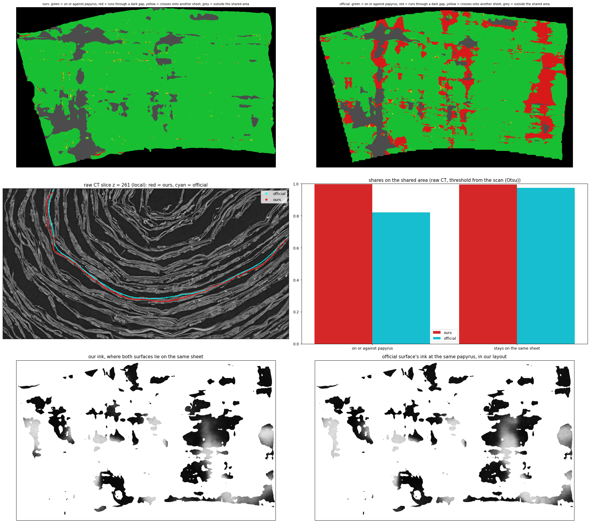
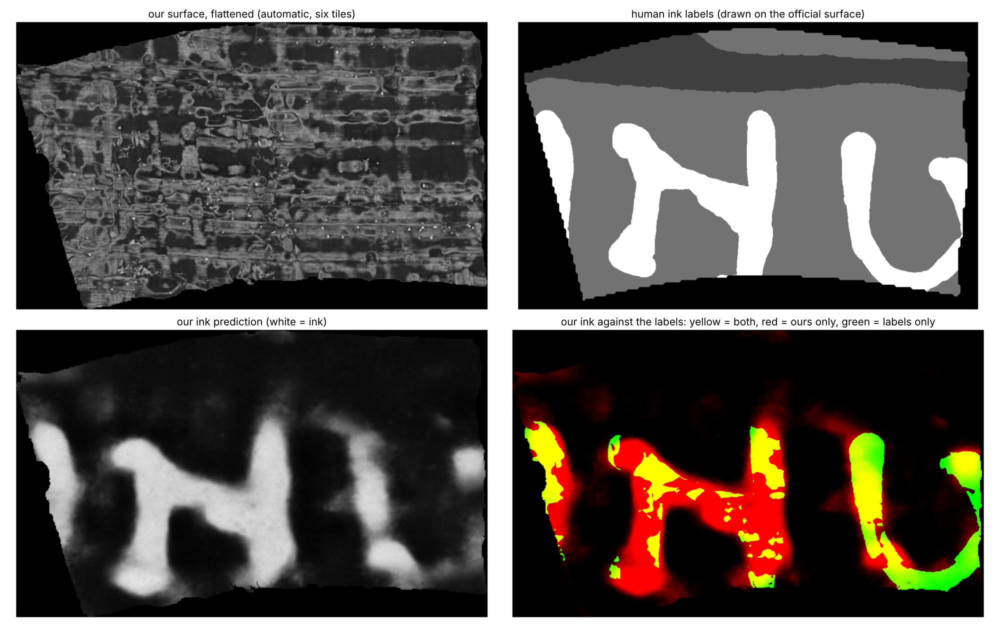

# Automatic layer separation and meshing for Herculaneum scroll CT

*A pipeline for the hard parts: it separates pressed and tangled papyrus layers by reading the recto and verso
plies, meshes them without smoothing away the wrinkles, and checks every surface against the raw CT. Built for
accuracy, not coverage. Its outputs double as labelled training data at the contacts where automatic segmentation
fails most.*

From raw CT to a flattened papyrus layer with ink, with no manual tracing.
Tested on PHerc. Paris 4 (ESRF 2.4 µm scan, read at level 2 = 9.6 µm).

**What you get:** run a block of tiles and you get every layer in it, not one. Each tile's layers are numbered
automatically (20–25 per tile here), and any layer can be followed across all the tiles and meshed, so one set of
tile runs gives a block of about 20 layers to unwrap, each with its own mesh, flat image, ink and self-checks.

**Status:** research code. Works end to end on a 2 × 3 block of tiles (about 4.8 × 7.6 mm of one layer).
Written and run in Google Colab, in a standard session. It runs in small tiles that fit a free session; larger
areas are covered by more tiles (see [Adjusting and scaling](#adjusting-and-scaling)). The full write-up is in
[WRITEUP.md](WRITEUP.md).

## What it does

The pipeline runs in four stages, each with its own runner. `config.py` says where the data is (scan, scroll
centre, tiles); each runner holds the settings for its stage.

| runner | phases | works on | gives |
|---|---|---|---|
| `run_pipeline.py` | 1–5 | one tile, all of its papyrus | tracks, pieces, sheets |
| `run_layers.py` | 6a–6d | one tile, all of its papyrus | every sheet numbered by layer |
| `run_mesh.py` | 7a–7b | one layer, followed across tiles | its mesh, flattened |
| `run_ink.py` | 8–10 | that one layer | flat image and ink |

1. **Tracks the papyrus (phases 1–5).** The CT tile is streamed from the open-data bucket (1). A structure tensor
   gives the local sheet direction (2) and a 3D U-Net gives sheet, recto and verso probabilities (3). Ridge
   tracking follows the papyrus and stops where it leaves it or meets a verso ply (4), giving about 50,000 short
   tracks per tile. Phase 5 groups the tracks into pieces and joins pieces into sheets.
2. **Undoes bad joins (6a).** `phase6a_split_sheets.py` returns joined sheets that lie on top of themselves (span
   two layers) to their pieces.
3. **Measures what lies between neighbouring sheets (6b).** `phase6b_pair_table.py` casts rays from each sheet to
   its neighbours and records whether a dark gap, a pressed contact or something unclear lies between them.
4. **Separates the layers using the papyrus itself (6c).** Each papyrus layer has two plies: the recto with fibres
   running around the scroll and the verso with fibres along its axis. `phase6c_ply_label.py` reads the ply order
   between neighbouring sheets at up to six spots per pair, and labels them *same layer* / *different layers* /
   *delaminated* / *same ply*. This resolves pressed spots where a dark-gap rule fails.
5. **Numbers the layers (6d).** `phase6d_stack_layers.py` orders all sheets through the stack, with the ply
   readings overruling the dark-gap rule within 80 voxels of where they were read, and reports every
   contradiction.
6. **Joins tiles (7a).** `phase7a_combine_tiles.py` matches the same layer across overlapping tiles (40-voxel
   overlap) and stitches it into one set.
7. **Meshes and flattens one layer (7b).** `phase7b_mesh.py` builds the surface from the layer's own tracks (folds
   and wrinkles kept), sets aside points that belong to a neighbouring layer, unrolls it, and runs eight
   self-checks.
8. **Reads ink (8–10).** `phase8_flat_grid.py` turns the mesh into a flat grid, with the writing upright and seen
   from the scroll centre. `phase9_ink_volume_extraction.py` samples 21 slices through the sheet. Phase 10 runs an
   ink model on them. Phase 10 is built to be swapped for another ink model (see `phase10_ink.py`).

## Results (PHerc. Paris 4, layer of the official segment)

Six tiles, each 192 × 416 × 416 voxels (z × y × x, 9.6 µm), each sharing 40 voxels with its neighbours.
Each tile was run on its own, then the same layer was matched across them. Tiles 1 and 4 use the original U-Net and
tiles 2, 3, 5 and 6 the retrained one, chosen per tile by which breaks fewer ply facts (write-up, section 4).

| Tile | Position | z | x | U-Net | Matching Layer | Overlap Points Within 3 Voxels |
|---|---|---|---|---|---|---|
| t1 | reference | 15534–15726 | 3895–4311 | original | 11 | reference |
| t2 | beside t1 | 15534–15726 | 4271–4687 | retrained | 12 | 95% |
| t3 | above t1 | 15382–15574 | 3895–4311 | retrained | 11 | 98% |
| t4 | below t1 | 15686–15878 | 3895–4311 | original | 10 | 95% |
| t5 | above t2 | 15382–15574 | 4271–4687 | retrained | 11 | 98% |
| t6 | below t2 | 15686–15878 | 4271–4687 | retrained | 11 | 99% |

Each tile numbers its own layers, so the same layer has a different number in each. Side by side, two tiles make
416 + 416 − 40 = 792 voxels wide; three stacked make 192 × 3 − 2 × 40 = 496 voxels tall. The joined layer unrolls
to 997 × 615 pixels (about 9.6 × 5.9 mm).

### Does the surface follow the papyrus? Ours against the official segment, judged by the raw CT

`checks/compare_surfaces.py` takes both surfaces where they cover the same area and asks the raw CT, thresholded
from the scan itself (Otsu), whether each surface lies on papyrus. Nothing from our pipeline is used as the judge.
A result is given only where it holds at the Otsu threshold and at 10% above and below it.

| test | four tiles, earlier run: ours / official | final six tiles: ours / official | final result |
|---|---|---|---|
| on or against papyrus (share of points) | 99.3% / 83.3% | 99.6% / 82.0% | ours better |
| runs through a dark gap (share of points) | 0.7% / 16.7% | 0.4% / 18.0% | ours better |
| stays on the same sheet (share of neighbour pairs) | 99.7% / 97.8% | 99.5% / 97.4% | ours better |
| layer crossings per 100 neighbour pairs | 0.11 / 0.18 | 0.22 / 0.19 | about equal |
| share of each surface compared | 83% / 65% | 87% / 91% | |


<br clear="all">
This measures how closely each surface follows a sheet in the CT; it does not score where in the sheet a surface
sits, or how well ink reads from it. Where both surfaces lie on the same sheet, the same ink model gives the same ink
on both (94% of 100,764 pixels agree).
### Does it read the same ink? Scored against the official segment's human labels (earlier run)

Six tiles, original U-Net and earlier layer settings; not repeated on the final surface. The same ink model and
reading (shift 5, 21 slices, 9.6 µm) on the official segment's surface and on ours, scored against the same human
labels:

| surface | ink score vs. human labels* | labelled ink found | labelled blank marked as ink |
|---|---|---|---|
| official segment (human-made) | +0.80 | 87% | 6% |
| ours (automatic, all six tiles) | +0.73 | 78% | 5% |

<br clear="all">
Ours is scored only where the official surface lies within 6 voxels of it (about half of our sheet). The labels
were drawn on the official surface.

\* Score = share of labelled ink marked as ink minus share of labelled blank marked as ink, on human-checked
pixels (0 = guessing, +1 = perfect). Sliding the labels out of place (230 trials) gives about −0.1, and +0.3 at
the 95th percentile.


### Layer separation per tile

"Broken" = share of ply readings that the final layer numbers contradict. "Doubled" = share of a layer's columns
where it shows as two bands instead of one (0 = one unbroken band).

| | t1 | t2 | t3 | t4 | t5 | t6 | mean |
|---|---|---|---|---|---|---|---|
| broken, original U-Net on every tile | 9% | 9% | 16% | 7% | 9% | 13% | 10.5% |
| broken, final tiles | 9% | 7% | 12% | 7% | 9% | 12% | 9.3% |
| worst doubled layer, original U-Net on every tile | 48% | 48% | 77% | 46% | 66% | 62% | 58% |
| worst doubled layer, final tiles | 48% | 46% | 48% | 46% | 53% | 55% | 49% |

The remaining doubling sits in a few layers per tile, mostly near the edges of the stack, where two layers are
pressed together with no ply reading nearby.

**Mesh** (final six-tile layer): 6 of 8 self-checks passed; 96.2% of the mesh lies on papyrus in the CT; the two
checks missed are just over their limits (distance from the band middle, and stretch 0.895–1.113 against
0.90–1.10).

**Compute** (standard Colab session with a T4 GPU, per 192 × 416 × 416 tile): phases 1–5 about 13–18 min, peak RAM
about 9 GB; phase 6 about 5–10 min. Meshing one layer across six tiles (5.07 million track points) takes about
30 min.

## Requirements

Phases 1–9:
```
pip install -r requirements.txt
```
A GPU helps for the U-Net (phase 3); everything else runs on CPU. The CT is streamed from the Vesuvius Challenge
open-data bucket (`s3://vesuvius-challenge-open-data/PHercParis4/volumes/...`); nothing has to be downloaded by
hand.

Phase 10 (ink) also needs the challenge's own code and model, which this repository does not include:
- The `vesuvius` package from [ScrollPrize/villa](https://github.com/ScrollPrize/villa) (MIT), built with
  `apt-get install libblosc-dev` and `pip install imagecodecs albumentations`.
- `step-075000.pth`, the published 9 µm ink model:
  [scrollprize/ink_9um](https://huggingface.co/scrollprize/ink_9um) (`hybrid_3d2d-seed42/`; MIT).

Model files in this repository:
- `phase3_unet_checkpoint.pt`: the U-Net that phase 3 uses by default (retrained: the original training with two
  fixes; see `train_phase3_unet.py`).
- `phase3_unet_checkpoint_v1.pt`: the original U-Net. To use it, set `UNET_CHECKPOINT` in `run_pipeline.py` to this
  file. Each tile's `manifest.json` records which checkpoint it used.
- `train_phase3_unet.py`: optional; retrains the U-Net (about 6 min on a T4). Not needed to run the pipeline.

## How to run

Run everything from the folder holding these scripts. Tiles are listed in `TILES` in `config.py`. A ready Colab
notebook is in `colab_quickstart.ipynb`.

**Per tile** (example: tile `t2`)
```
python run_pipeline.py t2        # phases 1-5   -> ckpt_t2/
python run_layers.py t2          # phases 6a-6d -> layers_t2/
```

**Per layer** (example: layer 11 of tile 1, across six tiles)
```
python run_mesh.py --tiles t1 t2 t3 t4 t5 t6 --layer 11
python run_ink.py --name layer11 --id 9611 --ckpt ./mesh_t1-t2-t3-t4-t5-t6_layer11 --wraps ./mesh_t1-t2-t3-t4-t5-t6_layer11/wraps
```
The first tile listed is the reference: its layer number is the one given. With one tile, `run_mesh.py` skips the
combining step.

**Checks** (optional; in `checks/`)
```
python checks/compare_surfaces.py --id 9611 --ckpt ./mesh_t1-t2-t3-t4-t5-t6_layer11 --official 9971 --official_offset 15382 4794 3895
python checks/compare_labels.py --id 9611 --ckpt ./mesh_t1-t2-t3-t4-t5-t6_layer11
```
Both need the official segment's surface files (and, for `compare_labels.py`, its ink labels) in the folder given
with `--official_dir`.

## Adjusting and scaling

Keep `config.py` and the four runners open for editing; that is where every adjustment is made. In Colab, open them
from the folder pane on the left; changes save straight away.

- **`config.py`: where the data is.** The scan, the scroll centre and the tiles. Add a tile here (a name and its
  z, y, x ranges) to process a new area. On another scroll, the scroll centre must be changed.
- **The `SETTINGS` block at the top of each runner: how each stage runs.** `run_pipeline.py` (phases 1–5),
  `run_layers.py` (phase 6), `run_mesh.py` (phase 7) and `run_ink.py` (phases 8–10).
- **One step by hand.** Every phase script takes its settings as command-line options (`python <script>.py -h`).
  This is the way to try a setting on one tile without changing the defaults, for example re-running phases 6c
  and 6d with other ply settings into separate folders and comparing the results. To use such a result in the mesh
  step, write it to the tile's standard folder (`layers_<tile>/`).
- **What to change, by symptom:** [TUNING.md](TUNING.md).
- **Another scroll.** The U-Net can be retrained on blocks of the scroll being processed, with no human labels
  (about 6 minutes on a T4). Keep the training set small and even: on PHerc. Paris 4, adding more blocks made layer
  separation worse. [TUNING.md](TUNING.md) explains how to set it up and how to tell whether it trained
  well.

**Scaling up.** Phase 6 numbers every layer in a tile (20–25 per 192 × 416 × 416 tile here; the outermost ones are
only small slivers at the tile's edge, and a layer near the edge of the stack may not reach every tile). Any layer
can then be followed across the tiles and meshed with `run_mesh.py`, one run per layer. There are two ways to
cover a larger area:
- **More tiles of the same size.** Each tile runs on its own, so the work grows with the number of tiles (about
  30 minutes each in a free Colab session), plus meshing, which grows with the layer's area (about 30 minutes for
  six tiles; much larger layers are untested and will take hours).
- **Bigger tiles,** on a machine with more memory. Memory grows roughly in proportion to the tile's volume (about
  9 GB for a 192 × 416 × 416 tile). The seed counts in phase 4 grow with the tile's volume on their own
  (`SEED_CAP_SCALES_WITH_TILE` in `run_pipeline.py`), so a bigger tile keeps the same density of tracks. Only the
  one tile size has been measured.
  - **Memory peaks in phase 5** (the pair search between tracks), so that is the step to watch on a bigger tile.
  - **Make each side of a tile a multiple of 8** (as 192 × 416 × 416 is). The U-Net halves the volume three times,
    so other sizes are padded at the edges and trimmed afterwards; that works, but multiples of 8 give exactly the
    tested behaviour. Tiles need not be cubes.

A larger sheet also helps the parts inside it: tile 1's area scored +0.81 against the human labels when meshed on its
own and +0.89 when meshed as part of four or six tiles, because its edges are no longer the sheet's edges.

## Outputs

| step | writes |
|---|---|
| run_pipeline.py | `ckpt_<tile>/`: tracks, pieces, joined sheets, compact CT and normals, `manifest.json` (written last) |
| run_layers.py | `pairs_<tile>/`, `plies_<tile>/`, `layers_<tile>/`: `layer_id.npy` (layer of every track), per-layer files, `ply_check.csv`, `ply_contradictions.csv` |
| run_mesh.py | `mesh_<tiles>_layerNN/wraps/wrap_layerNN_mesh_final.obj`, check picture and report |
| run_ink.py | `wrap_<id>_V3.tifxyz`, `wrap_<id>_ink/prediction.tif`, `diagnostics/ink_<id>.png` |

## Known limits

- Some layers stay partly doubled where two layers are pressed together with no ply reading nearby (worst layer
  46–55% on the final tiles, mostly near the edges of the stack).
- Two U-Net checkpoints are in use: the retrained one separates layers worse than the original on tiles 1 and 4.
  The model for each tile was chosen on tile-wide checks; for a given layer, the other may do better.
- The final mesh's unrolling stretches slightly more than the self-check allows (0.895–1.113 at the 5th–95th
  percentile, against 0.90–1.10).
- The flat grid is saved as one 3-channel TIFF, not yet as VC3D's tifxyz folder.
- Ink is read at 9.6 µm; strokes are about twice their real width. Higher resolution ink models can be used on top of the created mesh.
- Validated against human labels on one layer only (the official segment's), in an earlier run.
- The ink model's training data includes PHerc. Paris 4 segments, possibly this region; the comparison between our
  surface and the official one is fair (same model), but absolute scores may be optimistic.
- Tested on one scroll. The U-Net was trained mostly on PHerc. Paris 4 (one of its five blocks is PHerc. 332), and
  the settings were tuned there. Whether it does better than hand segmentation in wrinkled or unsegmented regions
  is a hypothesis, not yet tested.

## Related work

Semi-automatic segmentation with Volume Cartographer / VC3D ([ScrollPrize/villa](https://github.com/ScrollPrize/villa)),
which made the official segment; automatic pipelines such as
[ThaumatoAnakalyptor](https://github.com/schillij95/ThaumatoAnakalyptor), the 2024 automated-segmentation prize
entries, the fibre-winding graph solver in villa and [HerculeX](https://github.com/adambetka2/HerculeX), which cover
far larger areas. This pipeline focuses on telling pressed layers apart by their plies; see the write-up, section 11.

## Licence

MIT (see LICENSE).
