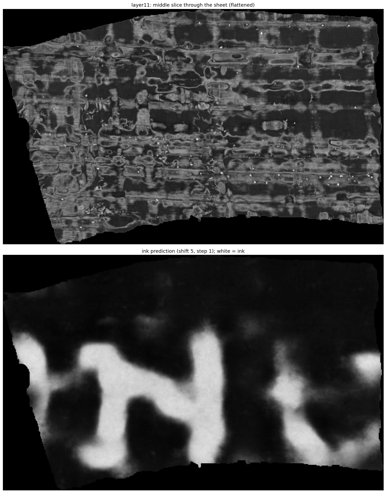
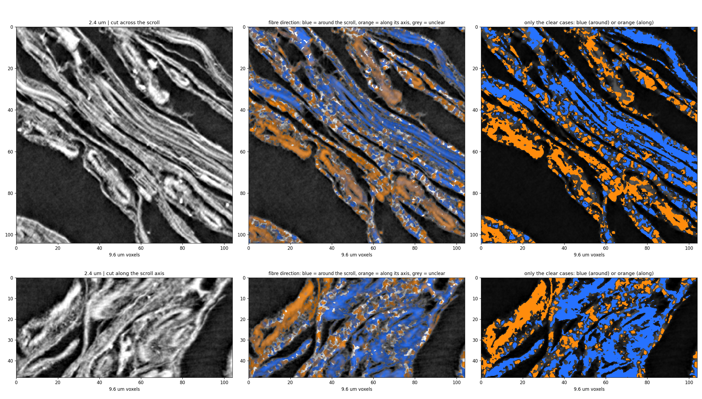
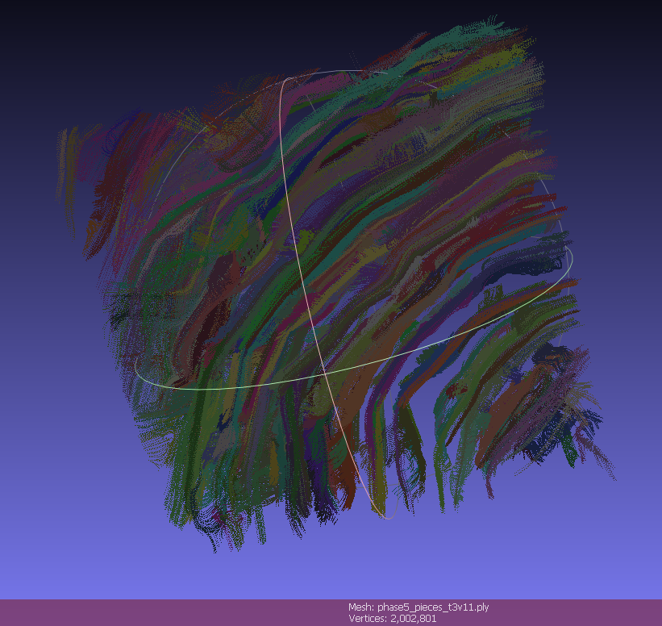
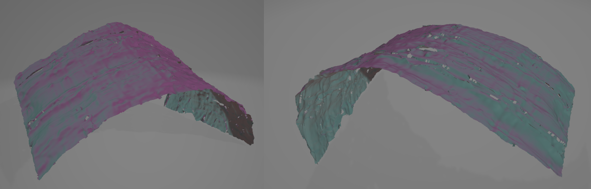
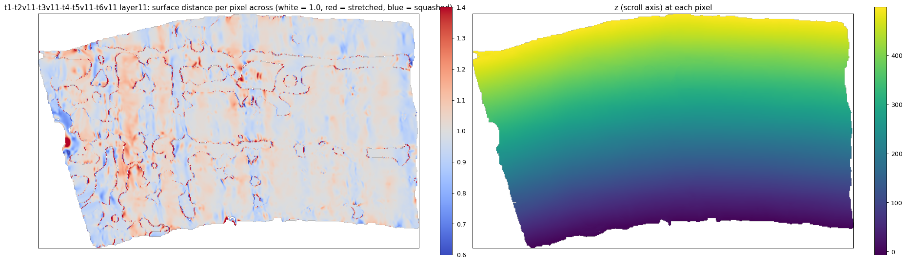
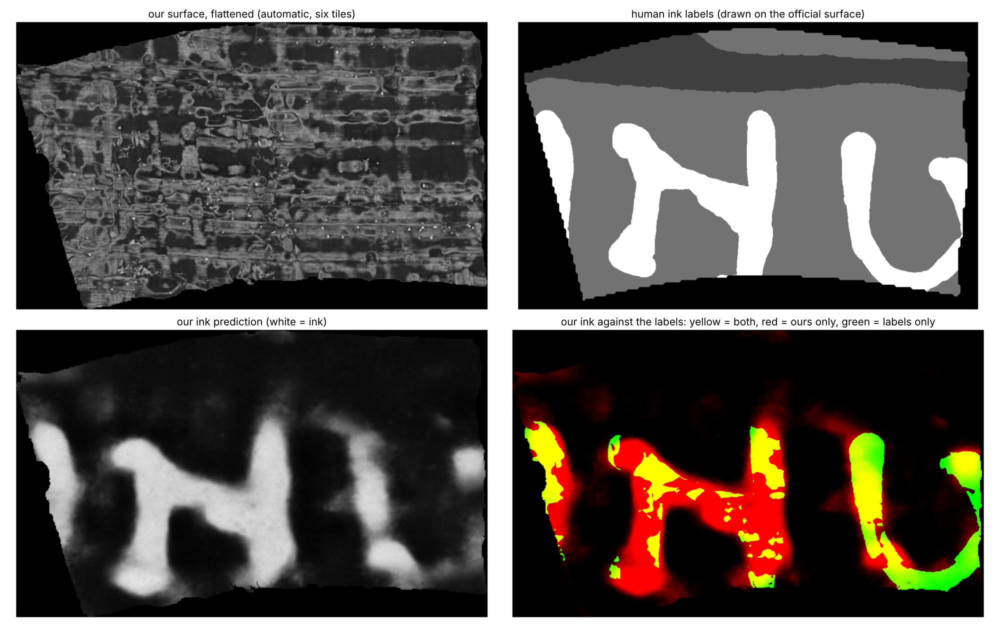

# Separating papyrus layers by their plies: automatic layer meshing for Herculaneum scroll CT

*PHerc. Paris 4, ESRF scan 20260411134726 (2.4 µm), processed at level 2 (9.6 µm). Equations and settings for
every step: [MATH.md](MATH.md).*

## Summary

*A pipeline for the hard parts: it separates pressed and tangled papyrus layers by reading the recto and verso
plies, meshes them without smoothing away the wrinkles, and checks every surface against the raw CT. Built for
accuracy, not coverage. Its outputs double as labelled training data at the contacts where automatic segmentation
fails most.*

This pipeline goes from raw CT to a flattened papyrus layer with ink, without manual tracing. Its main idea is to
separate neighbouring layers using the structure of the papyrus itself: every layer is two plies, a recto with
fibres running around the scroll and a verso with fibres running along its axis. Reading the order of the plies
between two sheets tells whether they are the same layer, two layers pressed together, or one layer whose plies
have come apart, which is exactly where a rule based on dark gaps fails.

On a block of 2 × 3 overlapping tiles (496 × 416 × 792 voxels), one layer was found, stitched across all six tiles
and unrolled into a flat image of 997 × 615 pixels (about 9.6 × 5.9 mm). The layer is matched across every tile
overlap, with 95–99% of overlap points within 3 voxels.

Judged by the raw CT alone, our automatic surface follows the papyrus more closely than the official, hand-made
segment of the same layer: **99.6%** of our surface lies on or against papyrus, against **82.0%** of the official
one, which runs through a dark gap between sheets at 18.0% of its points. Our surface also stays on the same sheet
more often (99.5% against 97.4%). The comparison covers 87% of our surface and 91% of the official one. Where both
lie on the same sheet, the same ink model gives the same ink on both (94% of pixels agree).

In an earlier run of the pipeline, read with the same ink model, our surface scored **+0.73** against the human ink
labels and the official surface, on which the labels were drawn, +0.80 (section 7).

Each tile takes about 15–18 minutes and up to about 9 GB of RAM in a standard Colab session with a T4 GPU, and the
six-tile layer meshes in the same session in about 30 minutes; larger areas are covered by more tiles (section 9).

## 1. The problem: telling layers apart where they touch

Tracking papyrus through the CT gives many short tracks that each follow one sheet. The hard part is deciding
which tracks belong to the same layer. Where two sheets are separated by a dark gap that is easy; but in about a
quarter to a third of all places we sampled, two sheets are pressed together with no gap between them.

We collected about 11,000–15,000 such pressed spots per tile where the answer was known from elsewhere on the same
two sheets. A dark-gap rule gets 40–61% of them right, no better than a coin. The best single measurement (the
distance between the two sheets) separates them only partly (0.78–0.82 on a 0.5–1 scale).

## 2. Reading the plies

**Why 9.6 µm.** The scan is 2.4 µm, but the whole pipeline runs on the level-2 volume (9.6 µm) on purpose:
it has 64 times fewer voxels. One 192 × 416 × 416 tile at 9.6 µm would be 768 × 1664 × 1664 at 2.4 µm,
over 2 billion voxels (about 8.5 GB as float32 before any processing), which does not fit a standard Colab
session. At 9.6 µm a tile runs in about 15–18 minutes and up to about 9 GB. The plies are still readable at this
resolution; the cost is fine detail, and ink strokes come out about twice their real width (see sections 7 and 12).

At each spot between two neighbouring sheets, `phase6c_ply_label.py` takes a short window of CT across the sheets
and reads the fibre direction at every depth: **H** (around the scroll, the recto) or **V** (along the axis, the
verso). Several spots are read per pair of sheets (2 or 6; see section 3).

Going outward, one layer reads H then V. So:

| reading between the two sheets | label |
|---|---|
| V … H (a verso, then the next recto) | different layers |
| H then V inside one band | same layer |
| an H-only band, a gap, then a V-only band, gap ≤ 12 voxels | same layer, delaminated |
| one band, same ply on both sheets, closer than one ply | same ply |
| no verso anywhere in the window | unreadable |

The measured ply thicknesses were the same in all six tiles: a single ply is about 8–9 voxels (≈ 80 µm),
a full layer (H + V) about 13–15 voxels (≈ 135 µm).

*The flattened sheet at seven depths (left) and the fibre direction at each (right; orange = H, around the
scroll; cyan = V, along its axis). Going inward, the sheet switches from mostly V (68% at +4.8 voxels) to mostly
H (59% at −2 to −5 voxels): the two plies of one layer, read across the whole sheet.*

Most doubled plies turned out to be local thickenings (lumps, overlaps, frayed fibre) rather than folds: genuine
fold signatures were rare (2–28 flags per tile).

## 3. From sheets to layers

1. **Undoing bad joins.** Stage 1 joins pieces into larger sheets. A joined sheet whose points lie on top of
   themselves (one layer stacked on another, measured as a "stacked" share) spans two layers and glues them
   together. `phase6a_split_sheets.py` returns those sheets (stacked ≥ 0.2) to their pieces and keeps every other
   join. On tile 2 this turned an 83%-double layer into two clean layers (9% and 21% double), kept a thin layer
   that splitting everything would have lost, and cut the ply facts that the layering breaks from 14% to 9%.
2. **Ordering the stack.** `phase6d_stack_layers.py` orders every sheet through the stack using dark gaps, with
   the ply readings overruling the gap rule near where they were read. It then checks itself: every ply fact the
   final layering breaks is listed, and every contradiction (two sheets the plies call different layers but a
   chain of "same layer" facts joins) is traced back to the fact most likely at fault.

**How much the ply readings help.** A layer is *doubled* where it shows as two bands in one column instead of one;
that is two layers merged. On tile 3, with the retrained U-Net (section 4), the same tile was layered four ways:

| ply readings used | worst doubled layer | layers over 30% doubled | sheet facts that hold |
|---|---|---|---|
| none (dark-gap rule only) | 69% | 7 | 87.1% |
| 2 spots per pair, used within 40 voxels | 48% | 5 | 89.7% |
| 6 spots per pair, used within 40 voxels | 39% | 4 | 90.7% |
| 6 spots per pair, used within 80 voxels | 35% | 3 | 90.6% |

On tile 2 the 6-spot, 80-voxel setting brought the worst doubled layer from 46% to 38% and cut the contradictions
from 148 to 60. On tiles 1 and 4 it made little difference either way. It is the default in `run_layers.py`. Each
step helps, but the doubling is not gone: what remains sits where two layers are pressed together with no ply
reading nearby, and the gap rule then calls them one layer.

## 4. The U-Net, and why more training data made it worse

A small 3D U-Net gives, for every voxel, the probability of sheet, recto and verso. It is trained without human
labels, on targets made from the structure tensor (see [MATH.md](MATH.md), phase 3). The tracker stops where the
verso probability rises above 0.6, so a track that reaches the verso ply of a layer ends there instead of running on
into the next layer.

Retraining fixed two mistakes in the original training: one of the five training blocks (from PHerc. 332) was
scaled to its own brightness range while the others were not, and the direction loss mixed the masks of different
patches in a batch. The fixed training (v1.1) uses the same five blocks as the original.

Adding more training data, six more blocks from around the scroll, made the pipeline worse, not better. Measured
on tile 3, where the verso output is above 0.6:

| model | training data | papyrus where verso > 0.6 |
|---|---|---|
| original (v1) | 5 blocks | 1.11% |
| fixed (v1.1) | the same 5 blocks | 1.23% |
| fixed, more data (v1.2) | 11 blocks | 0.02% |

With more data the network learned to hedge: its verso output stays near the middle and almost never passes the
tracker's stop. The tracker then runs across layer contacts, and layers merge. A version trained this way (v2, with
the extra blocks and random turns of the patches) separated layers worse than the original on three of four tiles
(ply facts broken: mean 12.8% against 10.3%). On a held-out block that no model trained on, the extra data did not
make the sheet, recto or verso outputs more accurate either; it improved only the fibre direction, which the
pipeline does not use.

**The fixed model against the original, on all six tiles.** The fixed model keeps the original's scale, so the
tracker's settings still fit it. It separated the layers better on four tiles and worse on two, tiles 1 and 4
(table in section 5). The difference follows the verso stops: on every tile, the better model is the one whose
tracks stop at a verso ply more often.

| tile | t1 | t4 | t3 | t2 | t5 | t6 |
|---|---|---|---|---|---|---|
| verso stops, original (v1) | 6,805 | 8,903 | 6,887 | 3,222 | about 3,500 | 3,982 |
| verso stops, fixed (v1.1) | 4,779 | 6,255 | 7,678 | 15,159 | 17,218 | 17,121 |
| better model | v1 | v1 | v1.1 | v1.1 | v1.1 | v1.1 |

The original model stopped often in the left column of tiles (t1, t3, t4) and rarely in the right (t2, t5, t6),
although the CT shows more verso on the right; the fixed model evened this out, which helped the right column and
cut the stops on tiles 1 and 4 by 30%. Why retraining moved the stops this way is not known.

**The final layer uses both models,** chosen per tile by one rule: keep the model whose layering breaks fewer ply
facts. The rule uses only the pipeline's own check, never the official segment, but it was chosen after seeing the
per-tile results. Tiles 1 and 4 come from the original model, tiles 2, 3, 5 and 6 from the fixed one. Both
checkpoints are in the repository (`phase3_unet_checkpoint.pt` is the fixed model and the default;
`phase3_unet_checkpoint_v1.pt` is the original), and each tile's `manifest.json` records which one it used. The
choice was made on tile-wide checks, so for any one layer the other model may do better.

**Other scrolls.** The U-Net is trained without human labels, so it can be retrained on blocks of the scroll being
processed. The lesson above sets the rule: keep the training set small and even (about five blocks of the original
size, replacing rather than adding), and check the result where it matters, in how the layers separate. The tuning
guide lists what to look for: held-out error below the "answer the average" baseline, verso stops in the thousands
per tile, and no more broken ply facts than the previous model on the same tile.

## 5. Stitching tiles

Six tiles, each 192 × 416 × 416 voxels, overlap their neighbours by 40 voxels. Each tile is run on its own, and
each numbers its own layers. `phase7a_combine_tiles.py` then follows one layer: in each overlap it finds the layer
of the new tile whose tracks lie on the reference layer's tracks.

| tile | position | z | x | U-Net, ply readings | matching layer | overlap points matched | within 3 voxels | median / 95th pct distance (voxels) | ply facts broken |
|---|---|---|---|---|---|---|---|---|---|
| t1 | reference | 15534–15726 | 3895–4311 | v1; 2 spots, 40 voxels | 11 | — | — | — | 57 of 619 (9%) |
| t2 | beside t1 | 15534–15726 | 4271–4687 | v1.1; 2 spots, 40 voxels | 12 | 96% | 95% | 0.9 / 3.0 | 44 of 599 (7%) |
| t3 | above t1 | 15382–15574 | 3895–4311 | v1.1; 2 spots, 40 voxels | 11 | 98% | 98% | 0.9 / 2.1 | 79 of 653 (12%) |
| t4 | below t1 | 15686–15878 | 3895–4311 | v1; 2 spots, 40 voxels | 10 | 98% | 95% | 0.9 / 3.0 | 42 of 568 (7%) |
| t5 | above t2 | 15382–15574 | 4271–4687 | v1.1; 6 spots, 80 voxels | 11 | 99% | 98% | 0.7 / 2.0 | 62 of 706 (9%) |
| t6 | below t2 | 15686–15878 | 4271–4687 | v1.1; 6 spots, 80 voxels | 11 | 99% | 99% | 0.7 / 1.7 | 74 of 599 (12%) |

In every overlap the runner-up layer had 6% or less, so the matches are unambiguous. Tiles from the two models line
up as closely as tiles from one model. The ply settings are those each tile was run with.

**Progress in layer separation.** Against the first full run, with the original model on every tile:

| tile | t1 | t2 | t3 | t4 | t5 | t6 | mean |
|---|---|---|---|---|---|---|---|
| ply facts broken, original model on every tile | 9% | 9% | 16% | 7% | 9% | 13% | 10.5% |
| ply facts broken, final tiles | 9% | 7% | 12% | 7% | 9% | 12% | 9.3% |
| worst doubled layer, original model on every tile | 48% | 48% | 77% | 46% | 66% | 62% | 58% |
| worst doubled layer, final tiles | 48% | 46% | 48% | 46% | 53% | 55% | 49% |

The middle layers of every final tile, where the followed layer runs, are the cleanest (layers 8–12 at 4–16%
doubled on tiles 5 and 6, for example); the worst doubling sits in a few layers near the edges of the stack.

## 6. Meshing and flattening one layer

`phase7b_mesh.py` builds the surface from the layer's own tracks, so folds and wrinkles are kept rather than
smoothed into a plane. Where the tracks spread wider than one band, points more than 5 voxels from the clean
layer's continuation are set aside as a neighbouring layer.

For the six-tile layer: 22,935 tracks (5.07 million points) became a mesh of 124,246 vertices and 244,736
triangles, in 28 minutes in a standard Colab session.

*The six-tile layer in 3D. It follows the curve of the scroll; small holes are places where no track was found.*

**Flattening.** To read ink, the curved mesh is unrolled into a flat image. The unrolling keeps the walking
distance between nearby points (up to 40 voxels), so distances on the papyrus are kept as closely as possible.
`phase8_flat_grid.py` then samples the surface every voxel, giving a 997 × 615 pixel image (495,272 pixels on the
sheet) in which each pixel stores the 3D point of the papyrus it shows. Turned so the reading side faces the
viewer and the writing is upright, this image is what the ink model reads.

*Half of all pixels are stretched by 1% or less, and 90% lie between 0.88 and 1.12 in both directions. The thin
red and blue rings are the edges of small holes; the solid patches are on the sheet's border.*

The mesh is checked eight ways: does it run down the middle of the papyrus band, cover the whole sheet, invent no
surface, form one clean surface, sit on papyrus in the CT, unroll without stretch, follow one layer, and keep its
own shape.

*The magenta is a neighbouring layer pressed against ours, most of all on the steep left arm: the one-band check
separates it from the layer being meshed.*

| tiles combined | U-Net | checks passed | on papyrus | stretch (5th–95th percentile) | set aside |
|---|---|---|---|---|---|
| t1 | original | 5 / 8 | 93.5% | 0.84–1.16 | 22.9% |
| t1 + t2 | original | 6 / 8 | 95.2% | 0.87–1.13 | 17.5% |
| t1 – t4 | original | 5 / 8 | 94.3% | 0.87–1.25 | 22.5% |
| t1 – t6 | original | 6 / 8 | 96.1% | 0.89–1.12 | 19.9% |
| **t1 – t6, final** | **per tile** | **6 / 8** | **96.2%** | **0.90–1.11** | **19.6%** |

The two checks the final mesh misses are near their limits: its 95th-percentile distance from the band middle is
2.5 voxels (limit 2.0), and the unrolling stretch range is 0.895–1.113 (limit 0.90–1.10). It passes the check that
it follows one layer (kept tracks within 8.1 voxels, 0.7% beyond 8), which the four-tile mesh failed.

## 7. Ink

`run_ink.py` samples 21 slices through the sheet, 5 voxels in from the surface towards the recto, and runs an ink
model on them (the published 9 µm model). On the final six-tile layer, 23% of the sheet is marked as ink, and the
letters stand out as broad strokes (summary image).

**Scored against human labels (earlier run).** The official segment of this region is the same layer, so its human
labels can score the ink directly (`checks/compare_labels.py` places the labels on our image wherever the official
surface lies within 6 voxels of ours). This was done on an earlier six-tile run, with the original model and the
earlier layer settings; it was not repeated on the final surface. To separate the surface from the ink model, the
same reading was also run on the official surface itself:

| surface (same ink model and reading) | area scored | score | labelled ink found | labelled blank marked as ink |
|---|---|---|---|---|
| official segment (hand-made; labels drawn on it) | 85.6% of its area | +0.80 | 87% | 6% |
| ours, whole six-tile block | 47.1% of our sheet | +0.73 | 78% | 5% |
| ours, tile 1's part only | 9.9% of our sheet | +0.89 | 97% | 8% |

*Score = share of labelled ink marked as ink minus share of labelled blank marked as ink (0 = guessing,
+1 = perfect). Sliding the labels out of place gives about −0.1, and +0.3 at the 95th percentile.*

On the labelled area, our surface found 78% of the labelled ink against 87% for the official surface, and marked
5% of blank papyrus as ink against 6%. Almost all of the ink we missed is in one letter (green in the overlay
below); section 8 looks at why.

**Checks that the ink belongs to this layer.**
- *Depth.* Reading 5 voxels in from the surface (towards the recto) scores +0.81; reading centred on the sheet
  scores +0.68, because half the window then falls on the verso and beyond.
- *Neighbouring layers.* In tile 1 the layer above ours carries marks of its own; the layer between them is blank
  at its recto and only picks up its outer neighbour's marks when the reading window reaches it. Comparing ink in
  3D showed the outer layer's marks do not sit over ours, so they are not ink transferred from our layer.

  

**A higher-resolution ink model can be used directly.** The surface is a set of 3D points, not a 9.6 µm image:
multiplying its coordinates by 4 places it in the full 2.4 µm scan. Any ink model, including the challenge's own
2.4 µm model, can therefore read our surface at full resolution with no change to the meshing. Phase 10 is built to
be swapped (`phase10_ink.py` states what a replacement must do). We used the 9.6 µm reading here to fit Colab;
reading at 2.4 µm should give strokes at their true width and is the next test.

## 8. Geometry compared with the official segment

In places our tracks follow the papyrus where the official segment crosses between bands. In the example below
(red = one of our tracks, cyan = other tracks, yellow = where the official segment cuts this slice), the tracks
stay on the bright band while the official surface passes through the dark gap into the next band.

**Measured over the whole shared area.** `checks/compare_surfaces.py` takes both surfaces where they cover the same
area and lets the raw CT judge them: a point counts as on papyrus if papyrus lies within 2 voxels of it along the
surface normal, with papyrus defined by a threshold taken from the scan itself (Otsu). Nothing from our pipeline is
used as the judge. A result is given only where it holds at the Otsu threshold and at 10% above and below it.

| test | four tiles, original model: ours / official | final six tiles: ours / official | final result |
|---|---|---|---|
| on or against papyrus (share of points) | 99.3% / 83.3% | 99.6% / 82.0% | ours better |
| runs through a dark gap (share of points) | 0.7% / 16.7% | 0.4% / 18.0% | ours better |
| stays on the same sheet (share of neighbour pairs) | 99.7% / 97.8% | 99.5% / 97.4% | ours better |
| layer crossings per 100 neighbour pairs | 0.11 / 0.18 | 0.22 / 0.19 | about equal |
| share of each surface compared | 83% / 65% | 87% / 91% | |
| ink agreement where both lie on the same sheet | 90% of 66,144 pixels | 94% of 100,764 pixels | (reported only) |

Moving from four tiles to six, the comparison came to cover almost all of both surfaces, and "stays on the same
sheet" went from about equal to ours better at all three thresholds. Layer crossings are about equal; at the
strictest threshold ours are higher (0.46 against 0.23), at the loosest lower (0.12 against 0.16). This test measures
how closely each surface follows a sheet in the CT; it does not score where in the sheet a surface sits, or how well
ink reads from it.

*Our surface is green almost everywhere, with red and yellow only in thin slivers. The official surface leaves the
papyrus in whole strips: vertical bands near the middle and about two-thirds across, and a large block on the right.
On the CT slice both follow the same sheet, a few voxels apart in places. Where both lie on the same sheet, their ink
maps are nearly identical.*

This matters for the score in section 7. Where the official surface leaves the papyrus, the human labels there were
drawn on a surface that is not on the sheet, so placing them on our image can mark ink where our layer has none, or
miss ink it has. Part of the gap between +0.73 and +0.80 may therefore come from the reference, not from our surface.
Whether the letter we missed lies where the official surface leaves the papyrus has not been checked yet.

## 9. Compute and scaling

| step | standard Colab session, T4 GPU |
|---|---|
| phases 1–5 (CT, structure tensor, U-Net, tracking, pieces, joins), per tile | about 13–18 min, peak about 9 GB RAM |
| phase 6 (split, pair table, ply readings, layers), per tile | about 5 min at 2 spots per pair, 10 min at 6 |
| combining tiles (phase 7a) | about 2 min |
| meshing one layer (phase 7b) | 23 min for four tiles (3.3 M points); 28 min for six tiles (5.07 M points) |

Retraining the U-Net takes about 6 minutes. The tiles were kept small on purpose, so that the whole pipeline runs in
a free session. Meshing six tiles first ran out of memory in the 12 GB session while refining the flat layout (65
million local distances); handling that list in chunks, with the same result, brought it within the session.

**Scaling up.** Phase 6 numbers every layer in a tile, so one run of phases 1–6 per tile gives all of its layers;
any of them can then be followed across tiles and meshed. A larger area can be covered in two ways:
- **More tiles of the same size.** Tiles run independently and phase 7a joins them, so the work grows with the
  number of tiles, plus meshing, which grows with the layer's area. From four tiles to six, meshing took about 7
  and 5.5 minutes per million points; much larger layers are untested and will take hours, mostly in the flat
  layout. Combining already-flattened sections, by matching the 3D points they share, would avoid re-meshing a
  whole large layer; it is not built yet.
- **Bigger tiles,** on a machine with more memory. Memory grows roughly in proportion to the tile's volume, since
  phase 5's pair search grows with the number of track points; phase 5 is where memory peaks. The seed counts in
  phase 4 grow with the tile's volume on their own, so the density of tracks stays the same. Each side of a tile
  should be a multiple of 8, because the U-Net halves the volume three times (other sizes are padded and trimmed).
  Only the one tile size has been measured.

A larger sheet also helps the parts inside it. Tile 1's area scored +0.81 against the human labels when meshed on its
own, +0.88 within two tiles and +0.89 within four or six, and the share of the mesh on papyrus rose from 93.5% (one
tile) to 96.2% (six tiles): a tile's edges stop being the sheet's edges, and the one-band check can follow the clean
layer across them. Not every measure improved at every step; the four-tile mesh stretched more than the one- and
two-tile meshes (section 6).

**Adjusting.** Where the data is (scan, scroll centre, tiles) is set in `config.py`; how each stage runs is set at
the top of its runner, and every phase script takes the same settings on the command line, so one step can be rerun
on one tile with other settings without changing the defaults. [TUNING.md](TUNING.md) lists what to change, by
symptom.

## 10. By-products that others can use

Every run writes labelled data as a by-product, and it characterises the scroll at the places where automatic
segmentation struggles most: where layers are pressed together. Each item comes with its position in the scan, so
it can be cut from the CT at any resolution and used to train or test other models. Because each run also checks
itself, every item comes with a measure of how far it can be trusted, so a user can keep only the most reliable
part.

| data (files, per tile) | how much, per tile | how far it is checked | what it can be used for |
|---|---|---|---|
| **Same layer or not, read from the plies** (`plies_<tile>/pair_spots.csv`, one row per spot; `pair_labels.csv`, one per pair) | 1,500–1,700 spots at 2 per pair, 3,400–3,800 at 6, over 750–860 pairs; about a third unreadable | the final layering breaks 7–12% of the pair facts; each contradiction is traced to the fact most likely at fault; spots read in four quarters, which agree at a typical 50–67% | training data for a model that decides whether two sheets belong together; a test any other segmentation can be scored against (how many ply facts does it break?) |
| **Hard examples: pressed spots with a known answer** (`pairs_<tile>/pair_samples.npz`, with ten measurements per spot) | about 11,000–15,000 | the answer comes from elsewhere on the same two sheets, so it is as good as that pair's label | a test set for telling pressed layers apart. Today's dark-gap rule gets 40–61% right; the best single measurement separates them at 0.78–0.82 (0.5 = useless). Samples from one pair resemble each other, so a model must be tested on pairs it never saw |
| **Ply direction** (H = recto, V = verso), in the ply readings and the U-Net's recto / verso output | every readable spot, and every voxel of the tile | on one sheet, the V ply lies outside the H ply for most pixels; ply thicknesses agree across all six tiles | teaching a model which side of the papyrus is which, and so which side carries the writing |
| **A layer number for every track** (`layers_<tile>/layer_id.npy`, `layers.csv`) | about 50,000 tracks and 8–9 million points | 89–93% of neighbouring sheet facts hold on the final tiles; each layer's share of doubled columns is reported | dense layer-instance labels across a block of the scroll, for training segmentation models |
| **Meshes, flat images and ink** (`mesh_<tiles>_layerNN/`, `wrap_<id>_*`) | one per layer meshed | eight self-checks per mesh; one layer compared with the official segment (99.6% against 82.0% on papyrus) | surfaces for ink models; a starting point for manual correction in other tools |
| **A surface check that needs no labels** (`checks/compare_surfaces.py`) | any two surfaces of the same layer | judged by the raw CT only, at three thresholds | quality control for any segmentation, including on scrolls with no human labels |

**Looking ahead.** The anchor for all of this is the one layer checked against the official segment. Where that
check agrees, the same pipeline's labels elsewhere in the block become a cheap source of training data that would
otherwise take hand tracing: thousands of answered same-layer / different-layer questions per tile, at exactly the
pressed contacts that are hardest. A model trained on them, and tested on pairs it never saw, could replace the
dark-gap rule at those contacts, which is where the remaining doubled layers come from (section 12).

## 11. Related work

[HerculeX](https://github.com/adambetka2/HerculeX), released in November 2026, follows a similar overall route:
structure-tensor sheet points, same-sheet links, rays to the next winding, and a solve that gives every patch its
winding. Its announcement reports much larger areas than this work. It does not describe a way of telling pressed
layers apart, which is the focus here.

## 12. Limits and next steps

- **Doubled layers.** Where two layers are pressed together with no ply reading nearby, the gap rule still joins
  them (worst layer 46–55% doubled on the final tiles, mostly near the edges of the stack). Next: a rule that two
  sheets seen stacked in the same columns cannot share a layer unless they are one recto and one verso ply.
- **Two models.** The fixed model separates layers worse than the original on tiles 1 and 4, where it stops less
  often at verso plies. Next: run the fixed model on those tiles with a slightly lower verso threshold
  (`TRACK["tau_verso"]` 0.55), together with one right-column tile to check it does not overshoot there; if it
  works, one model would serve every tile.
- **Model choice per tile, not per layer.** The model for each tile was chosen on tile-wide checks; for a given
  layer, the other model may do better. Only layer 11 is checked against anything outside the pipeline.
- **A weaker tile is only partly absorbed.** When tiles are meshed together, the one-band check sets aside a
  neighbouring layer's tracks (about 20% of points here) and the clean layer continues across tile edges, so some
  doubling in one tile does not reach the mesh. Where a layer is merged through and through, there is no clean
  continuation to follow.
- **Wrinkled and unsegmented regions (hypothesis).** The mesh keeps folds and wrinkles, and the official surface
  leaves the papyrus over whole strips, which suggests the pipeline may follow regions that are hard to segment by
  hand. This has not been tested on a region without an official segment. The self-checks (on papyrus in the CT,
  one layer, stretch, ply facts) need no human surface, so such a test is possible.
- **Single pieces that span two layers.** The split step only undoes joins. One stage-1 piece per tile or so
  lies on top of itself and still tangles a pair of layers. Next: split such pieces by depth.
- **Resolution.** Ink is read at 9.6 µm, so strokes come out about twice their real width. Next: read our surface
  in the 2.4 µm scan with a 2.4 µm ink model (section 7).
- **Missed ink.** Most of the ink we missed against the labels is in one letter. Next: check whether the official
  surface leaves the papyrus there (section 8), and score the final surface against the labels.
- **Validation.** Human labels exist only where the official segment runs; 47% of our six-tile sheet could be
  scored in the earlier run. Other layers have no labels to score against.
- **One scroll.** The U-Net was trained mostly on PHerc. Paris 4 (one of its five blocks is PHerc. 332), and the
  settings were tuned there. Other scrolls are untested.
- **Format.** The flat grid is saved as one 3-channel TIFF; a converter to VC3D's tifxyz folder is planned.
- **Scale.** Meshing time grows with area (28 minutes for six tiles); building the flat layout is the slow step.
  Next: combine flattened sections, or move the flat layout onto the GPU.

## Code

Repository: this one. Run order and options are in the [README](../README.md). MIT licence.
