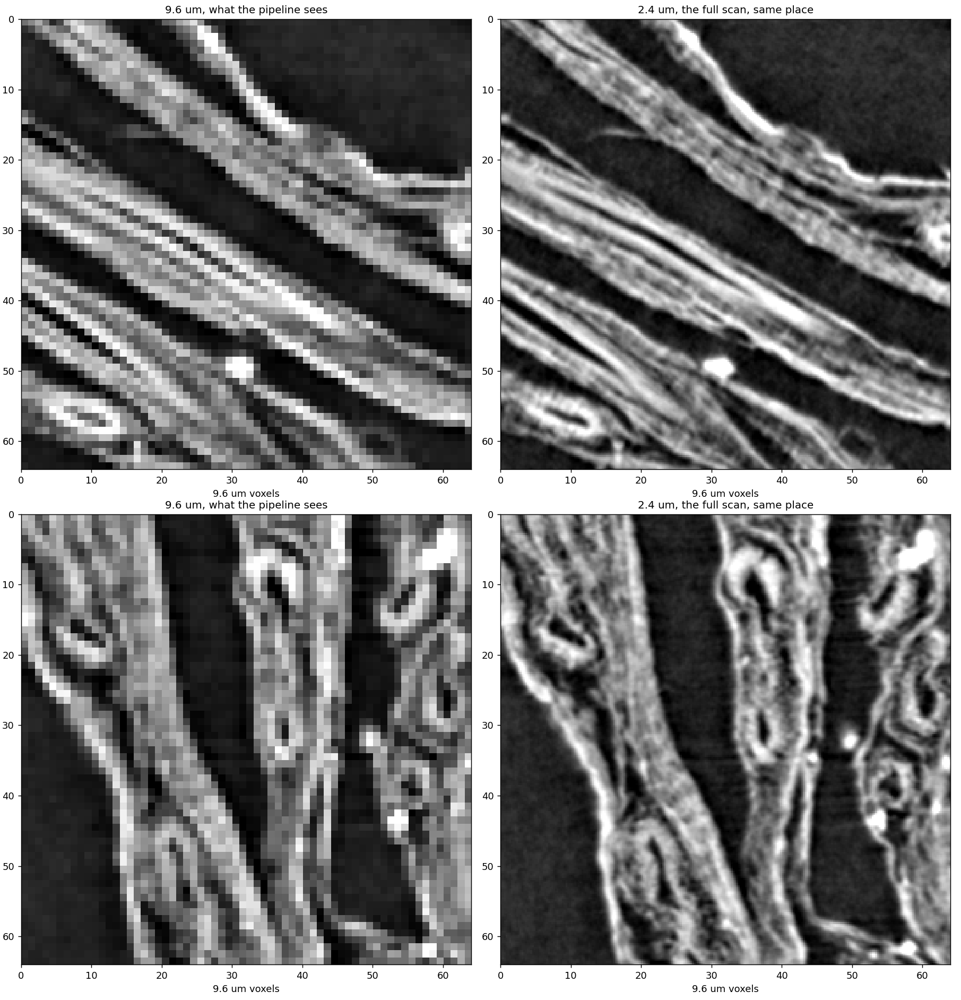
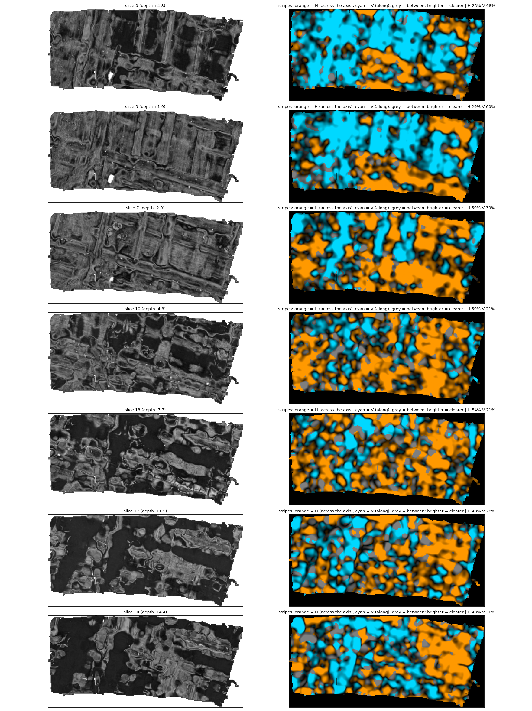
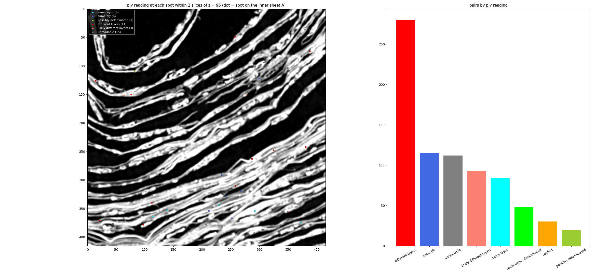
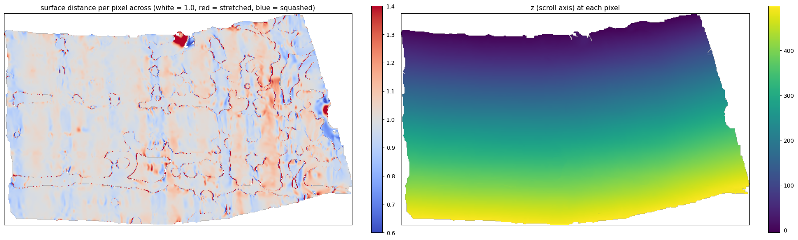
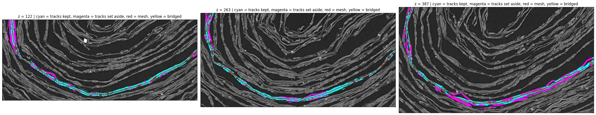
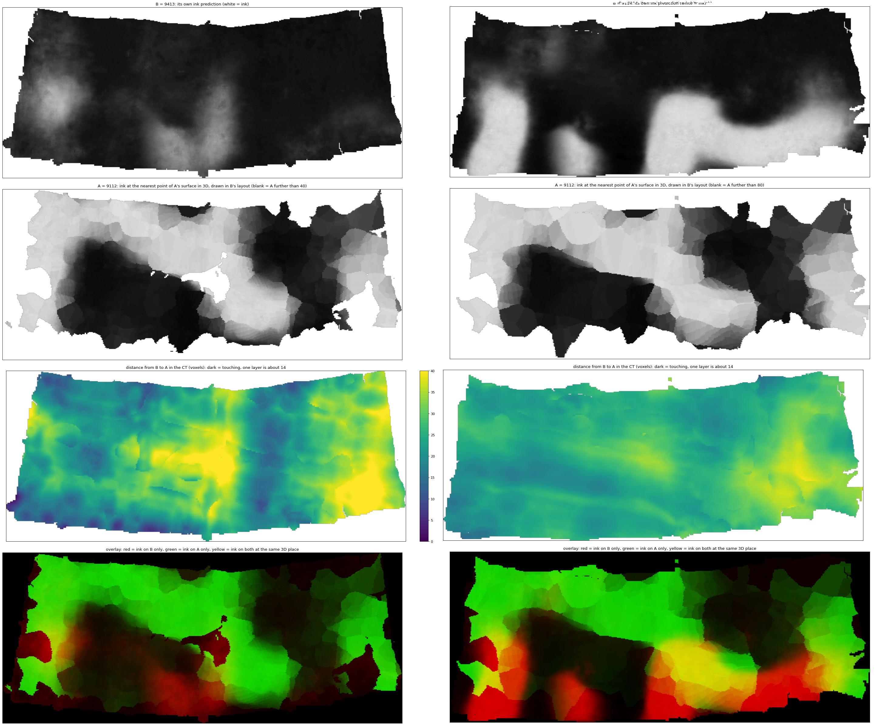

# Separating papyrus layers by their plies: automatic layer meshing for Herculaneum scroll CT

*PHerc. Paris 4, ESRF scan 20260411134726 (2.4 µm), processed at level 2 (9.6 µm). Equations and settings for
every step: [MATH.md](MATH.md).*

## Summary

This pipeline goes from raw CT to a flattened papyrus layer with ink, without manual tracing. Its main idea is to
separate neighbouring layers using the structure of the papyrus itself: every layer is two plies, a recto with
fibres running around the scroll and a verso with fibres running along its axis. Reading the order of the plies
between two sheets tells whether they are the same layer, two layers pressed together, or one layer whose plies
have come apart, which is exactly where a rule based on dark gaps fails.
 
On a block of 2 × 3 overlapping tiles (496 × 416 × 792 voxels), one layer was found, stitched across all six tiles
and unrolled to about 10.0 × 6.2 mm. Read with the same ink model, our automatic surface scores **+0.73** against
the human ink labels (78% of labelled ink found, 5% of labelled blank marked as ink; chance gives about +0.3), and
the hand-made official surface the labels were drawn on scores +0.80. The layer is matched across every tile
overlap, with 93–99% of overlap points within 3 voxels. Each tile takes about 13 minutes and 12 GB of RAM in a
standard Colab session.
 

## 1. The problem: telling layers apart where they touch

Tracking papyrus through the CT gives many short tracks that each follow one sheet. The hard part is deciding
which tracks belong to the same layer. Where two sheets are separated by a dark gap that is easy; but in about a
quarter to a third of all places we sampled, two sheets are pressed together with no gap between them.
 
We collected 12,000–15,000 such pressed spots per tile where the answer was known from elsewhere on the same two
sheets. A dark-gap rule gets 44–55% of them right, no better than a coin. The best single measurement (the
distance between the two sheets) separates them only partly (0.78–0.81 on a 0.5–1 scale).
 

## 2. Reading the plies

**Why 9.6 µm.** The scan is 2.4 µm, but the whole pipeline runs on the level-2 volume (9.6 µm) on purpose:
it has 64 times fewer voxels. One 192 × 416 × 416 tile at 9.6 µm would be 768 × 1664 × 1664 at 2.4 µm,
over 2 billion voxels (about 8.5 GB as float32 before any processing), which does not fit a standard Colab
session. At 9.6 µm a tile runs in about 13 minutes and 12 GB. The plies are still readable at this resolution;
the cost is fine detail, and ink strokes come out about twice their real width (see sections 6 and 10).
 

 
At each spot between two neighbouring sheets, `ply_label.py` takes a short window of CT across the sheets and
reads the fibre direction at every depth: **H** (around the scroll, the recto) or **V** (along the axis, the verso).
 

 
Going outward, one layer reads H then V. So:
 
| reading between the two sheets | label |
|---|---|
| V … H (a verso, then the next recto) | different layers |
| H then V inside one band | same layer |
| an H-only band, a gap, then a V-only band, gap ≤ 12 voxels | same layer, delaminated |
| one band, same ply on both sheets, closer than one ply | same ply |
| no verso anywhere in the window | unreadable |
 
The measured ply thicknesses were the same in all six tiles: a single ply is about 8–9 voxels (≈ 80 µm),
a full layer (H + V) about 13–15 voxels (≈ 135 µm).
 

*The flattened sheet at seven depths (left) and the fibre direction at each (right; orange = H, around the
scroll; cyan = V, along its axis). Going inward, the sheet switches from mostly V (68% at +4.8 voxels) to mostly
H (59% at −2 to −5 voxels): the two plies of one layer, read across the whole sheet.*
 

 
Most doubled plies turned out to be local thickenings (lumps, overlaps, frayed fibre) rather than folds: genuine
fold signatures were rare (2–13 flags per tile).

## 3. From sheets to layers

1. **Undoing bad joins.** Stage 1 joins pieces into larger sheets. A joined sheet whose points lie on top of
   themselves (one layer stacked on another, measured as a "stacked" share) spans two layers and glues them
   together. `split_sheets.py` returns those sheets (stacked ≥ 0.2) to their pieces and keeps every other join.
   On tile 2 this turned an 83%-double layer into two clean layers (9% and 21% double), kept a thin layer that
   splitting everything would have lost, and cut the ply facts that the layering breaks from 14% to 9%.
2. **Ordering the stack.** `stack_layers.py` orders every sheet through the stack using dark gaps, with the ply
   readings overruling the gap rule within 40 voxels of where they were read. It then checks itself: every ply
   fact the final layering breaks is listed, and every contradiction (two sheets the plies call different layers
   but a chain of "same layer" facts joins) is traced back to the fact most likely at fault.

## 4. Stitching tiles

Six tiles, each 192 × 416 × 416 voxels, overlap their neighbours by 40 voxels. Each tile is run on its own, and
each numbers its own layers. `combine_tiles.py` then follows one layer: in each overlap it finds the layer of the
new tile whose tracks lie on the reference layer's tracks.
 
| tile | position | z | x | matching layer | overlap points matched | within 3 voxels | median / 95th pct distance (voxels) | ply facts broken |
|---|---|---|---|---|---|---|---|---|
| t1 | reference | 15534–15726 | 3895–4311 | 11 | — | — | — | 57 of 619 (9%) |
| t2 | beside t1 | 15534–15726 | 4271–4687 | 12 | 96% | 93% | 0.9 / 3.8 | 61 of 675 (9%) |
| t3 | above t1 | 15382–15574 | 3895–4311 | 9 | 99% | 98% | 0.9 / 2.3 | 107 of 667 (16%) |
| t4 | below t1 | 15686–15878 | 3895–4311 | 10 | 98% | 95% | 0.9 / 3.0 | 42 of 568 (7%) |
| t5 | above t2 | 15382–15574 | 4271–4687 | 12 | 99% | 96% | 0.7 / 2.7 | 69 of 737 (9%) |
| t6 | below t2 | 15686–15878 | 4271–4687 | 12 | 99% | 99% | 0.7 / 1.6 | 79 of 620 (13%) |
 
In every overlap the runner-up layer had 10% or less, so the matches are unambiguous. Tile 3's higher count of
broken ply facts comes from one stage-1 piece that lies across two other layers (see Limits); the layer followed
here is not one of them.

## 5. Meshing and flattening one layer

`phase6_track_surface.py` builds the surface from the layer's own tracks, so folds and wrinkles are kept rather
than smoothed into a plane. Where the tracks spread wider than one band, points more than 5 voxels from the clean
layer's continuation are set aside as a neighbouring layer.
 
For the six-tile layer: 23,281 tracks (5.17 million points) became a mesh of 124,029 vertices and 244,350
triangles, in 37 minutes.
 

*The six-tile layer in 3D. It follows the curve of the scroll; small holes are places where no track was found.*
 
**Flattening.** To read ink, the curved mesh is unrolled into a flat image. The unrolling keeps the walking
distance between nearby points (up to 40 voxels), so distances on the papyrus are kept as closely as possible.
`mesh_to_grid.py` then samples the surface every voxel, giving a 997 × 607 pixel image (494,354 pixels on the
sheet) in which each pixel stores the 3D point of the papyrus it shows. Turned so the reading side faces the
viewer, this image is what the ink model reads.
 

 
*Half of all pixels are stretched by less than 1%, and 90% lie between 0.87 and 1.12. The thin red and blue rings
are the edges of small holes; the two solid red patches are on the sheet's border.*
 
The mesh is checked eight ways: does it run down the middle of the papyrus band, cover the whole sheet, invent no
surface, form one clean surface, sit on papyrus in the CT, unroll without stretch, follow one layer, and keep its
own shape.
 

 
| tiles combined | checks passed | on papyrus | stretch (5th–95th percentile) | set aside |
|---|---|---|---|---|
| t1 | 5 / 8 | 93.5% | 0.84–1.16 | 22.9% |
| t1 + t2 | 6 / 8 | 95.2% | 0.87–1.13 | 17.5% |
| t1 – t4 | 5 / 8 | 94.3% | 0.87–1.25 | 22.5% |
| t1 – t6 (all six) | 6 / 8 | 96.1% | 0.89–1.12 | 19.9% |
 
The two checks the six-tile mesh misses are near their limits: the mesh's 95th-percentile distance from the band
middle is 2.5 voxels (limit 2.0), and the unrolling stretch range is 0.894–1.119 (limit 0.90–1.10).

## 6. Ink

`read_ink.py` samples 21 slices through the sheet, 5 voxels in from the surface towards the recto, and runs an
ink model on them. The official segment of this region is the same layer, so its human labels score the result
directly (`compare_labels.py` places the labels on our image wherever the official surface lies within 6 voxels
of ours).
 
To separate the surface from the ink model, the same reading was also run on the official surface itself:
 
| surface (same ink model and reading) | area scored | score | labelled ink found | labelled blank marked as ink |
|---|---|---|---|---|
| official segment (hand-made; labels drawn on it) | 85.6% of its area | +0.80 | 87% | 6% |
| ours, whole six-tile block | 47.1% of our sheet | +0.73 | 78% | 5% |
| ours, tile 1's part only | 9.9% of our sheet | +0.89 | 97% | 8% |
 
*Score = share of labelled ink marked as ink minus share of labelled blank marked as ink (0 = guessing,
+1 = perfect). Sliding the labels out of place gives about −0.1, and +0.3 at the 95th percentile.*
 
Our surface reads the same letters as the hand-made one, with fewer false marks. Almost all of the difference is
ink missed in one letter (right-hand side of the overlay below); section 7 looks at why.

**Checks that the ink belongs to this layer.**
- *Depth.* Reading 5 voxels in from the surface (towards the recto) scores +0.81; reading centred on the sheet
  scores +0.68, because half the window then falls on the verso and beyond.
- *Neighbouring layers.* In tile 1 the layer above ours carries marks of its own; the layer between them is blank
  at its recto and only picks up its outer neighbour's marks when the reading window reaches it.
  Comparing ink in 3D (`ink_overlap.py`) showed the outer layer's marks do not sit over ours, so they are not
  ink transferred from our layer.
  
  **A higher-resolution ink model can be used directly.** The surface is a set of 3D points, not a 9.6 µm image:
multiplying its coordinates by 4 places it in the full 2.4 µm scan. Any ink model, including the challenge's own
2.4 µm model, can therefore read our surface at full resolution with no change to the meshing. We used the
9.6 µm reading here to fit Colab; reading at 2.4 µm should give strokes at their true width and is the next test.

## 7. Geometry compared with the official segment

In places our tracks follow the papyrus where the official segment crosses between bands. In the example below
(red = one of our tracks, cyan = other tracks, yellow = where the official segment cuts this slice), the tracks
stay on the bright band while the official surface passes through the dark gap into the next band.

This matters for the comparison in section 6. Where the official surface leaves our layer, two things happen:
- the human labels there were drawn on a surface that is not on our layer, so placing them on our image can mark
  ink where our layer has none, or miss ink it has;
- where the official surface runs through a gap or along the wrong band, the ink it shows may come from a
  neighbouring layer.
Either way, part of the gap between +0.73 and +0.80 may come from the reference, not from our surface. The flat
image of the official surface supports this: its middle slice is mostly smooth dark grey with scattered bright
patches, while ours shows papyrus fibre across the whole sheet. This has not been measured yet. The next step is
to compare, over the same area, the share of each surface that lies on papyrus in the CT, and to check whether
the letters we miss sit where the official surface leaves our layer.

## 8. Compute

| step | per tile (192 × 416 × 416) |
|---|---|
| stage 1 (CT, structure tensor, U-Net, tracking, pieces, joins) | about 13–14 min, peak 11–12 GB RAM |
| stage 2 (split, pair table, ply labels, layers) | about 6 min |
| meshing one layer | about 7–8 min per million track points (six tiles, 5.17 M points: 37 min) |
 
All runs used a standard Google Colab session.

## 9. By-products that others can use

Every run writes labelled data as a by-product. Most automatic segmentation struggles where layers are pressed
together, and that is exactly where this data is richest. Each item comes with its position in the scan, so it
can be cut from the CT at any resolution.
 
- **Same layer or not, with the answer known.** For every readable pair of neighbouring sheets: same layer /
  different layers / delaminated / same ply, with the position of each reading (600–740 ply facts per tile).
  Training data for a model that decides whether two sheets belong together.
- **Hard examples.** 12,000–15,000 pressed spots per tile where the two sheets touch with no gap, and whose answer
  is known from elsewhere on the same two sheets. The dark-gap rule scores about 50% on them, so they make a
  demanding test set.
- **Ply direction.** H (recto) or V (verso) at every depth through the sheets, which can teach a model to tell
  the two sides of the papyrus apart, and so which side carries the writing.
- **A layer number for every track** in every tile, and for every point of every stitched layer: dense
  layer-instance labels across a whole block of the scroll.
- **Meshes, flat images and ink predictions** for each processed layer, with eight quality checks each.
The same output also serves as a check on other methods: any segmentation can be tested against the ply facts it
breaks.

## 10. Limits and next steps

- **Single pieces that span two layers.** The split step only undoes joins. One stage-1 piece per tile or so
  lies on top of itself and still tangles a pair of layers (e.g. 2 of 22 layers in tile 3). Next: split such
  pieces by depth.
- **Resolution.** Ink is read at 9.6 µm, so strokes come out about twice their real width. Next: read our surface
  in the 2.4 µm scan with a 2.4 µm ink model (section 6).
- **Missed ink.** Most of the ink we miss against the labels is in one letter. Next: check whether the official
  surface leaves our layer there (section 7).
- **Validation.** Human labels exist only where the official segment runs; 47% of our six-tile sheet could be
  scored. Other layers have no labels to score against.
- **Format.** The flat grid is saved as one 3-channel TIFF; a converter to VC3D's tifxyz folder is planned.
- **Scale.** Tiles of twice the volume should fit in Colab memory; the tracking seed count is being made to scale
  with tile size.

## Code

Repository: this one. Run order and options are in the [README](../README.md). MIT licence.
