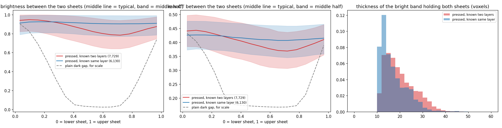
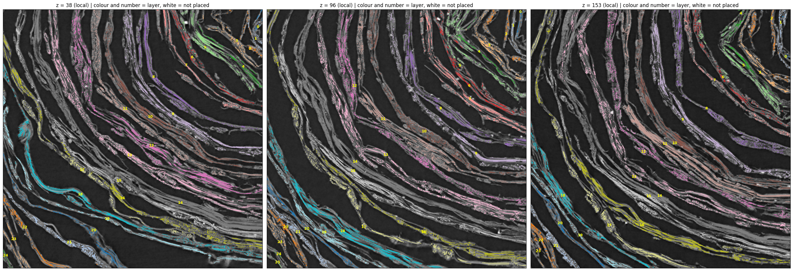
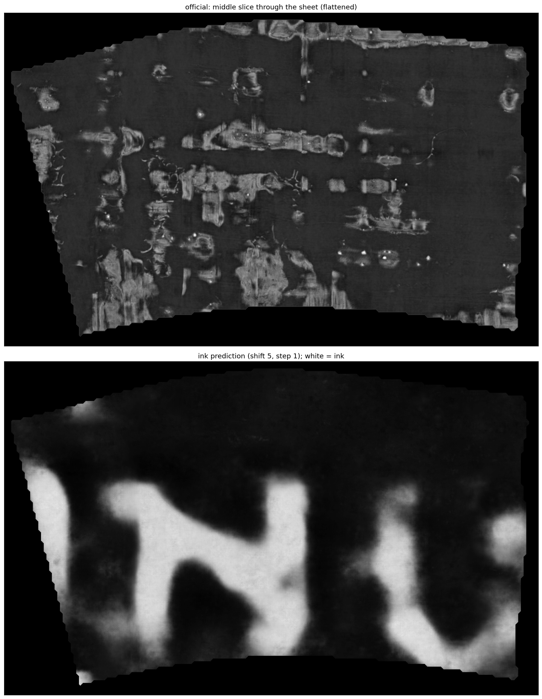
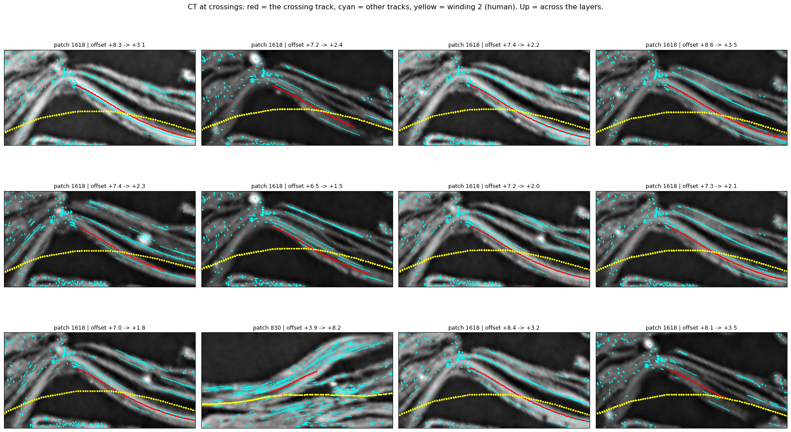

# Separating papyrus layers by their plies: automatic layer meshing for Herculaneum scroll CT

*Draft write-up. PHerc. Paris 4, ESRF scan 20260411134726 (2.4 µm), processed at level 2 (9.6 µm).*

## Summary

This pipeline goes from raw CT to a flattened papyrus layer with ink, without manual tracing. Its main idea is to
separate neighbouring layers using the structure of the papyrus itself: every layer is two plies, a recto with
fibres running around the scroll and a verso with fibres running along its axis. Reading the order of the plies
between two sheets tells whether they are the same layer, two layers pressed together, or one layer whose plies
have come apart, which is exactly where a rule based on dark gaps fails.

On a block of 2 × 3 overlapping tiles (about 4.8 × 7.6 mm of one layer), the automatically found layer gives ink
that scores **+0.89** against the human labels of the official segment (97% of labelled ink found, 8% of
labelled blank marked as ink; chance gives about +0.3), and the same layer is matched across every tile overlap
with 96–99% agreement. Each tile takes about 13 minutes and 12 GB of RAM in a standard Colab session.

## 1. The problem: telling layers apart where they touch

Tracking papyrus through the CT gives many short tracks that each follow one sheet. The hard part is deciding
which tracks belong to the same layer. Where two sheets are separated by a dark gap that is easy; but in about a
quarter to a third of all places we sampled, two sheets are pressed together with no gap between them.

We collected 12,000–15,000 such pressed spots per tile where the answer was known from elsewhere on the same two
sheets. A dark-gap rule gets 44–55% of them right, no better than a coin. The best single measurement (the
distance between the two sheets) separates them only partly (0.78–0.81 on a 0.5–1 scale).

## 2. Reading the plies

At each spot between two neighbouring sheets, `ply_label.py` takes a short window of CT across the sheets and
reads the fibre direction at every depth: **H** (around the scroll, the recto) or **V** (along the axis, the verso).
Going outward, one layer reads H then V. So:

| reading between the two sheets | label |
|---|---|
| V … H (a verso, then the next recto) | different layers |
| H then V inside one band | same layer |
| an H-only band, a gap, then a V-only band, gap ≤ 12 voxels | same layer, delaminated |
| one band, same ply on both sheets, closer than one ply | same ply |
| no verso anywhere in the window | unreadable |

The measured ply thicknesses were the same in all six tiles: a single ply is about 8–9 voxels (≈ 80 µm),
a full layer (H + V) about 13–15 voxels (≈ 135 µm).

Most doubled plies turned out to be local thickenings (lumps, overlaps, frayed fibre) rather than folds: genuine
fold signatures were rare (2–13 flags per tile).

*[caption to fill in: what this fold picture shows]*

## 3. From sheets to layers

1. **Undoing bad joins.** Stage 1 joins pieces into larger sheets. A joined sheet whose points lie on top of
   themselves (one layer stacked on another, measured as a "stacked" share) spans two layers and glues them
   together. `split_sheets.py` returns those sheets (stacked ≥ 0.2) to their pieces and keeps every other join.
   On tile 2 this turned an 83%-double layer into two clean layers (9% and 21% double), kept a thin layer that
   splitting everything would have lost, and cut the ply facts that the layering breaks from 14% to 9%.
2. **Ordering the stack.** `stack_layers.py` orders every sheet through the stack using dark gaps, with the ply
   readings overruling the gap rule within 40 voxels of where they were read. It then checks itself: every ply
   fact the final layering breaks is listed, and every contradiction (two sheets the plies call different layers
   but a chain of "same layer" facts joins) is traced back to the fact most likely at fault.

| tile | ply facts broken by the final layering |
|---|---|
| t1 | 57 of 619 (9%) |
| t2 | 61 of 675 (9%) |
| t3 | 107 of 667 (16%) |
| t4 | 42 of 568 (7%) |
| t5 | 69 of 737 (9%) |
| t6 | 79 of 620 (13%) |

## 4. Stitching tiles

Tiles are 192 × 416 × 416 voxels with 40 voxels of overlap. `combine_tiles.py` follows one layer: in each
overlap it finds the layer of the new tile whose tracks lie on the reference layer's tracks.

| tile | matched layer's overlap points within 3 voxels of the reference | median / 95th percentile distance (voxels) |
|---|---|---|
| t2 (side) | 96% | 0.9 / 3.8 |
| t3 (above) | 99% | 0.9 / 2.3 |
| t4 (below) | 98% | 0.9 / 3.0 |
| t5 (above t2) | 99% | 0.7 / 2.7 |
| t6 (below t2) | 99% | 0.7 / 1.6 |

In every overlap the runner-up layer had 10% or less, so the matches are unambiguous.

## 5. Meshing and flattening one layer

`phase6_track_surface.py` builds the surface from the layer's own tracks, so folds and wrinkles are kept rather
than smoothed into a plane. Where the tracks spread wider than one band, points more than 5 voxels from the clean
layer's continuation are set aside as a neighbouring layer. The surface is unrolled by keeping local walking
distances (up to 40 voxels) and checked eight ways: does the mesh run down the middle of the papyrus band, cover
the whole sheet, invent no surface, form one clean surface, sit on papyrus in the CT, unroll without stretch,
follow one layer, and keep its own shape.

| layer | checks passed | on papyrus | stretch (5th–95th percentile) | set aside |
|---|---|---|---|---|
| 1 tile | 5 / 8 | 93.5% | 0.84–1.16 | 22.9% |
| 2 tiles | 6 / 8 | 95.2% | 0.87–1.13 | 17.5% |
| 4 tiles | 5 / 8 | 94.3% | 0.87–1.25 | 22.5% |
| 6 tiles | _to fill in_ | | | |

## 6. Ink

`read_ink.py` samples 21 slices through the sheet and runs an ink model. The official segment of this region lies
on our layer, so its human labels score the result directly (`compare_labels.py`; the labels cover the official
segment's area only).

| layer | score | labelled ink found | labelled blank marked as ink |
|---|---|---|---|
| 1 tile | +0.81 | 95% | 14% |
| 2 tiles | +0.88 | 96% | 8% |
| 4 tiles | +0.89 | 97% | 8% |
| 6 tiles | _to fill in_ | | |

The score improves as tiles are added: the larger sheet gives the mesher more good area to steer by.

**Checks that the ink belongs to this layer.**
- *Depth.* Reading 5 voxels in from the surface (towards the recto) scores +0.81; reading centred on the sheet
  scores +0.68, because half the window then falls on the verso and beyond.
- *Neighbouring layers.* In tile 1 the layer above ours carries marks of its own; the layer between them is blank
  at its recto and only picks up its outer neighbour's marks when the reading window reaches it.
  Comparing ink in 3D (`ink_overlap.py`) showed the outer layer's marks do not sit over ours, so they are not
  ink transferred from our layer.

## 7. Geometry compared with the official segment

In places our tracks follow the papyrus where the official segment crosses between bands. In the example below
(red = one of our tracks, cyan = other tracks, yellow = where the official segment cuts this slice), the tracks
stay on the bright band while the official surface passes through the gap into the next band.

*[to add: share of each surface lying on papyrus in the CT over the same area, ours vs the official segment]*

*[caption to fill in]*

 
*[caption to fill in]*

## 8. Compute

| step | per tile (192 × 416 × 416) |
|---|---|
| stage 1 (CT, structure tensor, U-Net, tracking, pieces, joins) | about 13–14 min, peak 11–12 GB RAM |
| stage 2 (split, pair table, ply labels, layers) | about 6 min |
| meshing one layer | about 8 min per million track points (six tiles: about 40 min) |

All runs used a standard Google Colab session.

## 9. By-products that others can use

- **Ply labels** for every readable pair of neighbouring sheets (same layer / different layers / delaminated /
  same ply), with the position of each reading.
- **Hard examples:** 12,000–15,000 pressed spots per tile whose answer is known from elsewhere on the same two
  sheets, a test set on which the dark-gap rule scores about 50%.
- **A layer number for every track** in every tile.

These could serve as training or test data for models that decide "same layer or not" in densely packed regions.

## 10. Limits and next steps

- **Single pieces that span two layers.** The split step only undoes joins. One phase-5 piece per tile or so
  lies on top of itself and still tangles a pair of layers (e.g. 2 of 22 layers in tile 3). Next: split such
  pieces by depth.
- **Resolution.** Ink is read at 9.6 µm, so strokes come out about twice their real width. The current challenge
  ink model works at 2.4 µm; the next test is reading our surface at 4.8 or 2.4 µm.
- **Validation.** Human labels exist only on the official segment's layer and area. Cutting the official surface
  for the whole six-tile block would let all of it be scored.
- **Format.** The flat grid is saved as one 3-channel TIFF; a converter to VC3D's tifxyz folder is planned.
- **Scale.** Tiles of twice the volume should fit in Colab memory; the tracking seed count is being made to scale
  with tile size.

## Code

Repository: this one. Run order and options are in the [README](../README.md). MIT licence.
